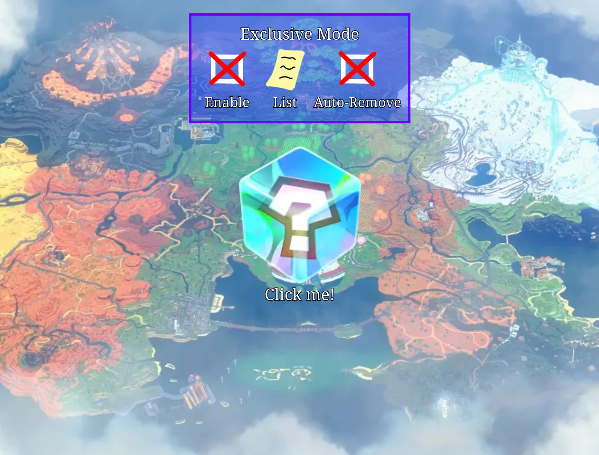
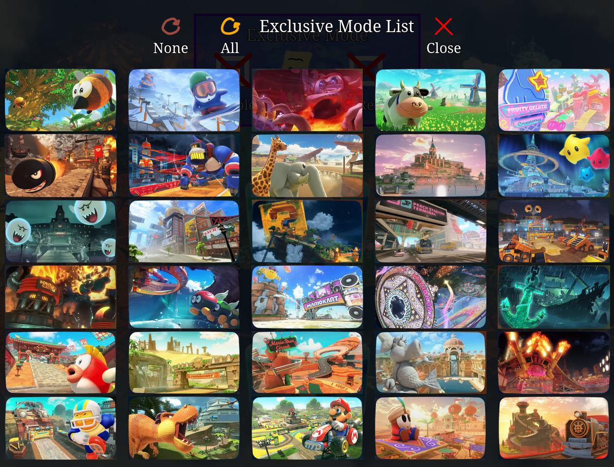
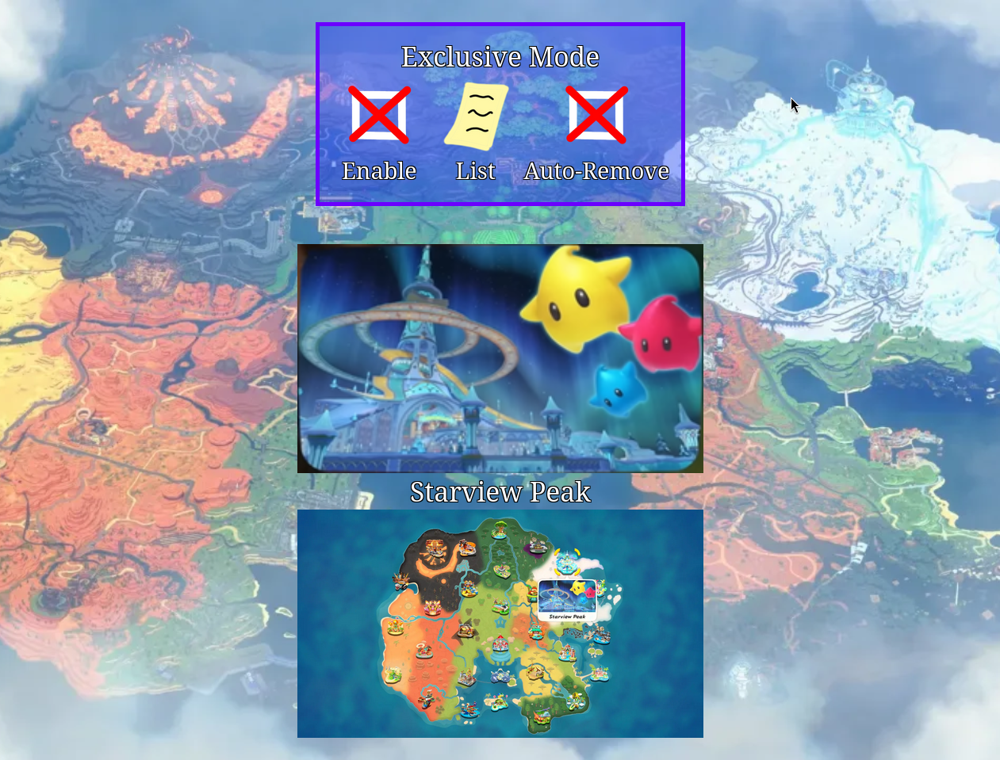

# Mario Kart Course Select

## Overview

A webpage for giving random courses in Mario Kart World.

Features:
  - Full randomization of the course list
  - Exclusive mode for avoiding repeats
  - Retro Tracks toggle for including or leaving out the retro courses
  - Browser-based auto save/load of course list state

## Course list

The files in `images/courses/` are the single source of truth for which
courses exist. Base courses live directly in `images/courses/`; retro
courses live in `images/courses/retro/`. `courses.js` is generated from
those directories:

    node generate-courses.mjs

To add or remove a course, add or remove its `.webp` in `images/courses/`
(or `images/courses/retro/` for a retro course) and a matching map in
`images/maps/` (or `images/maps/retro/`), re-run the generator, and commit
the regenerated `courses.js`. The list UI and map cache in the page are
built from the generated lists at load time, with the retro courses placed
at the end of the list. The generator also warns if the map folders do not
match the course folders, and stops if the same name is in both the base
and retro folders.

The generator also writes the numbered history markers shown on the map,
`images/numbers/1.svg` up to one per course, and removes any left over
from a larger course list.

A new course also needs a map marker position in `course_locations` in
`script.js`.

Course names are the filenames without extension. Filenames may include
spaces and special characters like apostrophes (the page URL-encodes them
when loading images). Characters that are invalid in filenames, like `?`,
are percent-encoded in the filename (e.g. `Great %3F Block Ruins.webp`) and
decoded for display, so the course still shows up as `Great ? Block Ruins`.
The generator warns if a filename contains characters that are invalid on
Windows.

## Screenshots

## Contact

Created by benjamin.w.massey@gmail.com
